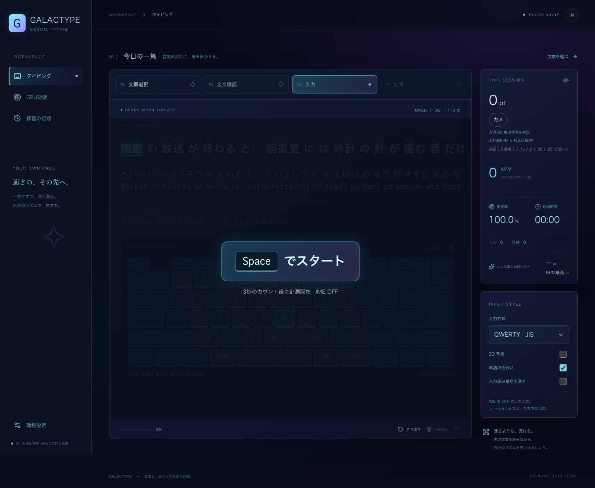

# GALACTYPE

指先から、宇宙へ。長文・単語・CPU対戦を楽しむ、宇宙テーマのタイピングゲーム。

文章選択・全文確認・入力・結果を、横スライドする4面のカルーセルで切り替えます。練習中は現在の一文と次の一文を表示し、先を読みながら自分のリズムで打てます。通常練習・タイプウェル・打鍵トレーナーは入力画面でSpaceを押すと3・2・1を表示し、3秒後から計測・入力を開始します。開始待ち・カウントダウン・一時停止を入力領域中央のオーバーレイに表示します。「Spaceでスタート」はクリックでも開始でき、「再開する」は大きなボタンで再開できます。開始用Spaceとカウント中の入力は打鍵・ミス・記録に含めません。Escape・フォーカス喪失・非表示・ページ／ステップ移動・やり直しでカウントを取り消し、再度Spaceで開始できます。一時停止からの再開にはカウントを挟みません。CPU対戦は従来どおりカウントダウンで同時に始まります。



[一時停止と再開の画面](docs/practice-paused-desktop.png)

## 起動

Node.js 24、pnpm 11.25.0 を利用します。

```sh
corepack enable
pnpm install
pnpm dev
```

ブラウザで http://localhost:5173 を開きます。ビルドは `pnpm build`、ビルド結果の確認は `pnpm preview`。静的ホスティングには `dist/` を配置できます（ルートパス配信を想定）。

## 練習

1. 「文章選択」画面に統合したライブラリのグリッドから、好みの一篇を選びます。ジャンルで絞り込み、タイトル・説明で検索できます。選択中のカードにチェックと枠を表示します。文学・旅・科学・日常・思索・音楽のオリジナル文章を各 3 段落、合計 6 編に加え、日本国憲法前文（4段落）の全文を収録しています。
2. 「全文を読む」で全段落を確認し、「この文章でスタート」で入力画面へスライドします。上部のステップでも移動できます。全文・文章選択へ戻ると一時停止します。画面は一度に1面だけ表示し、隠れた面はキーボード操作の対象から除外します。
3. 入力方式を選び、**IME を OFF / 直接入力**にします。入力領域をクリックし、Spaceキーを押します。3秒のカウントダウン後に計測と入力が始まります。句読点も入力します。
4. 入力に合わせてガイドが変わります。誤入力は進行せず、ミスとして計上。Backspace で戻す必要はありません。
5. Escape または一時停止で休止できます。入力欄からフォーカスが外れたとき、タブが非表示になったときも自動休止。再開ボタンから続きを打てます。休止時間は計測に含めません。
6. 全段落を完走すると記録し、専用の「結果」画面へ自動で切り替えます。「結果」ステップは完走後に選べます。途中の練習は保存しません。「やり直す」、文章・入力方式の変更で最初からになります。

本文は句点ごとに一文ずつ進み、次の一文を小さく控えめに表示します。本文の現在位置はシアンで強調し、入力済み部分は暗く表示します。漢字の連続部分は対応する読み全体を一つの単位として強調し、かなは一文字単位で進みます。かな入力の濁点・半濁点は入力し終わるまで同じ文字を強調します。ミスでは位置が進みません。独立した「現在の読み」欄は設けず、メイン文章の直下にひらがな、その下にローマ字、最後に次の文章を表示します。入力済みローマ字を残し、残りの候補と次の一打を表示します。入力ガイドは常に表示します。本文・ひらがな・ローマ字は折り返さず、それぞれ1行のまま入力位置へ滑らかに左送りし、画面幅変更にも追従します。かな入力ではローマ字を非表示にし、濁点の入力途中も「が」などを分断せず表示します。入力ガイドのON/OFF設定はなく、過去にOFFにしていても有効になります。かな入力はかなガイドを常時表示します。3D 背景も OFF にできます。本文と読みの対応は `src/passageReadings.ts` の明示的なデータで管理し、全文との一致をテストしています。新しい文章を追加する場合は漢字の読み対応も追加してください。本文は漢字かな混じり、判定は手動で用意した読みを使います（助詞「は」は `ha`）。

キーボードガイドはキーの共通ピッチ、行のずれ、Tab/Caps/Shift/Backspace/Spaceの幅、JISの縦長Enterを実物に近づけています。担当指ごとにネオンの色で区分し、F・Jにホーム位置の目印を表示します。次に押すキーだけが発光します（Shiftが必要な場合はShiftキーも発光）。選択したJIS／US／Dvorak／Colemak／Workman／かな配列に連動し、必要なShiftは反対側の手を案内します。かな入力の濁点・半濁点も別キーとして追従します。一時停止・完走中は発光を止めます。画面上のキーボードは表示ガイドで、クリック入力は行いません。

漢字の上には、対応データの読みをふりがなとして表示します。単語の色分けはデフォルトONです。右側の「単語の色分け」で本文・かな・ローマ字の配色を切り替えられ、保存済みのON/OFF設定を優先します。4面のカルーセルは同じ高さを維持し、次へ進むと左へ、前へ戻ると右へスライドします。全文確認では長い段落を画面幅に合わせて折り返し、縦にスクロールして確認できます。入力中の本文・かな・ローマ字は1行表示を維持します。「入力済み単語を消す」をONにすると、打ち終えた単語を非表示にし、残りを左へ送ります。OFFでは従来どおり入力済み部分をグレーアウトします。どちらもこのブラウザに保存します。濁点・半濁点や漢字の読みの途中で単語を消すことはありません。入力中の送りはOSの「動きを減らす」に従い、スライドは環境設定の「画面切り替えのアニメーション」に従います。

各ページは上部のキャッチフレーズを省き、文章選択・対戦・記録の操作を直接表示します。

## 独自メニューと画面切り替え

入力方式・CPUプリセット・文章セット・打ち方・記録分析の比較対象と指標・リプレイ速度は、ブラウザ標準のプルダウンを使わず、共通の独自コンボボックスで表示します。クリック／タップに加え、矢印キー・Home/End・PageUp/PageDown・文字検索で候補を移動し、Enter/Spaceで確定できます。Tabは候補を確定して次のコントロールへ進み、Escape・外側クリックは変更せずに閉じます。無効な候補は選べません。DOMフォーカスは開いたコントロールに保ち、候補のフォーカスを`aria-activedescendant`で伝えます。メニューはスクロール枠の外に表示し、画面の上下・左右からはみ出さないよう配置します。[WAI-ARIA APGの選択専用コンボボックス](https://www.w3.org/WAI/ARIA/apg/patterns/combobox/examples/combobox-select-only/)を参考にしています。

ページの移動はフェード＋縦送り、カルーセルは進むと左へ、戻ると右へ、0.65秒かけてなめらかにスライドして切り替えます。回転と光のスイープは使いません。枠の高さは4面とも固定し、内容は枠内で縦にスクロールします。画面外の面は`inert`で入力対象から外します。環境設定の「画面切り替えのアニメーション」で「オン」（初期値）・「OSに合わせる」・「オフ」を選べます。「オン」ではOSの「動きを減らす」が有効でもページ・カルーセルの切り替えを動かし、「OSに合わせる」ではOS設定に従い、「オフ」では常に停止します。設定はブラウザに保存します。背景・打鍵・ミス・メニュー・結果の演出は引き続きOSの「動きを減らす」に従います。

## 終了画面

通常練習・e-typing・RTC文章セット・タイプウェル・60秒トレーナーを終えると、タイプウェルの記録確認を参考にした専用の結果面を表示します。pointと称号を大きく表示し、KPM・所要時間・正確率・正打鍵数・実ミス数、同じ文章セット／配列／モード／出題バージョンの過去最高と前回pointを確認できます。タイプウェルは基準400/280打と実打鍵数を区別します。ゴースト完走時も同じ形式の結果画面で勝敗とミスを確認できます。

結果には1秒ごとの速度グラフとミスの印、間違えた箇所（問題番号・文字・正解キー・実際の誤入力・回数・最初の時刻）、時間がかかった文章の上位5件を表示します。ミスは同じ問題・入力位置・正解キー・誤入力ごとに集計し、上位30箇所を表示します。ロスは正打鍵間隔の中央値を超えた待ち時間の目安です。グラフのKPMは正しい実打鍵数から算出するため、タイプウェルの基準打鍵KPMとは区別します。

「全打鍵・リプレイを確認」から、既存の秒ごとの推移・文字／文章のロス・全打鍵ログ・リプレイを開けます。結果の閲覧や再生では記録を追加しません。「もう一度」で入力面へ戻り、「文章を選び直す」で選択面へ戻ります。

CPU戦は各ラウンド終了時に専用の結果を表示し、そのラウンドの10点先取スコア・勝者・正確率95%による逆転の有無・point・ミス・速度推移・ログを確認してから「次のラウンド」へ進みます。ラウンドのログはそのラウンドを0秒とする時間軸で表示します。BO7全体を終えると勝利／敗北画面に切り替え、全体スコアと各ラウンドの勝敗一覧を表示し、「再戦する」へ進めます。カウントダウン・幕間・結果を見ている時間は計測に加えません。ラウンド単位の結果は対戦中に保持し、ローカル履歴への保存は従来どおり全対戦完了時の1件だけです。

## point・称号

point = floor(正打鍵KPM × 補正正確率²)、補正正確率 = 正打鍵数 / (正打鍵数 + 加重ミス数)。途中経過・完走結果・履歴にpointと称号を表示します。pointに上限はなく、1000pt以上は最高称号に固定します。

ptには連続誤打の加重ミス数を使います。1回目から順に重み1、0.75、0.5、0.35、0.25、以降も0.25を加算し、正しい打鍵で連続回数をリセットします。実際の誤打数とミス箇所数（連続誤打を1箇所に集約）は別に残し、既存の正確率表示・RTC判定はミス箇所数を使います。長い別表記の途中やかなの濁点でも、正しい打鍵が入れば次のミスを別に数えます。誤打で費やした時間は速度に反映されます。既存の履歴は当時のミス数でpointを算出し、「旧ミス方式」と表示します。

称号は50pt刻みの21段階です。過去の記録画面にも現在の称号を適用します。

| 下限pt | 称号             | CPU KPM | CPU反応時間 |
| -----: | ---------------- | ------: | ----------: |
|      0 | カメ             |      35 |       250ms |
|     50 | ハリネズミ       |      85 |       244ms |
|    100 | コアラ           |     135 |       237ms |
|    150 | リス             |     185 |       231ms |
|    200 | アライグマ       |     235 |       224ms |
|    250 | パンダ           |     285 |       218ms |
|    300 | タヌキ           |     335 |       211ms |
|    350 | ネコ             |     385 |       205ms |
|    400 | キツネ           |     435 |       198ms |
|    450 | イヌ             |     485 |       192ms |
|    500 | ウサギ           |     535 |       185ms |
|    550 | シマウマ         |     585 |       179ms |
|    600 | シカ             |     635 |       172ms |
|    650 | カンガルー       |     685 |       166ms |
|    700 | サラブレッド     |     735 |       159ms |
|    750 | ダチョウ         |     785 |       153ms |
|    800 | ヌー             |     835 |       146ms |
|    850 | ガゼル           |     885 |       140ms |
|    900 | スプリングボック |     935 |       133ms |
|    950 | プロングホーン   |     985 |       127ms |
|   1000 | チーター         |    1035 |       120ms |

走る速さをイメージした独自のゲーム内ランクです。計算式は[福島高専のe-typing活用報告（2019、p.40）](https://www.jstage.jst.go.jp/article/rrie/1/0/1_39/_pdf/-char/ja)を参考にしています。連続誤打の減点補正と独自称号を用いるため、当アプリのpointはe-typingの公式スコアとは別に扱います。

## CPU対戦

サイドバーの「CPU対戦」で設定し、開始します。通常練習と同じ6配列・ふりがな・表示オプションが使えますが、**次の文章は表示しません**。「RTCオリジナル」の短文20問に加え、登録済みの全文章セットを選べます。e-typingの6セット、さくさくタイピング、憲法前文、タイプウェルの各辞書も使用でき、両者が同じ問題を同時に開始します。

- 一問を先に打ち切った側へ1点。10点先取で1ラウンド、4ラウンド先取（BO7）で勝利します。
- 先取した側が正確率95%未満、相手が95%以上なら相手がラウンドを獲得します。CPUは無誤打のため、プレイヤーが先に10点を取っても95%未満ならCPUのラウンドになります。正確率には同じ連続ミス集約を使います。同時完了は入力中の速度・正確率のトータルポイントで比較します。
- 各ラウンド冒頭に3秒のカウントダウン、各問題の終了後に650msの入力不能時間があります。連打の持ち越しによる意図しないミスを防ぎます。
- KPMはCPUの定常速度。反応時間は出題から**最初のキー**が入るまでの時間です。一定速度と、時定数700msで定常速度へ近づくイーズインを選べます。反応と加速を含む全体の実測KPMは設定値より低くなります。
- プリセットは称号と同じ21段階・35〜1035 KPMで、反応時間はカメ250ms〜チーター120msです。人間の反応をイメージしたゲーム内の調整用プリセットです。設定はこのブラウザに保存します。
- Escape、一時停止、フォーカス離脱、ブラウザの非表示で停止し、再開までCPUの時計も止まります。対戦中の設定変更はリセット後に行います。別のアプリ内画面へ移ると進行中のCPU対戦は終了します。完了した対戦だけを履歴へ1回保存します。

ルールの参照: [RTC2025公式の競技ルール](https://www.realforce.co.jp/events/202503_typing-championship/)、[Weather Typing公式FAQ（速度・正確性・トータルポイント）](https://denasu.com/software/wtfaq.html)。大会ワードはユーザー提供のRTC ZIP内XMLを使用しています（下記参照）。大会の画像素材は含めません。

## 入力方式

| 方式       | 動作                                                                                    |
| ---------- | --------------------------------------------------------------------------------------- |
| QWERTY JIS | `KeyboardEvent.key` を使い、JIS の記号位置を OS に従って処理                            |
| QWERTY US  | `KeyboardEvent.code` で US 配列の物理キーを復元                                         |
| Dvorak     | 物理キーを標準US Dvorakに変換。OSはQWERTYのまま使用                                     |
| Colemak    | 物理キーを標準Colemak（Mod-DHではない）に変換。US記号位置、OSはQWERTY                   |
| Workman    | 物理キーを標準Workmanに変換。US記号位置、OSはQWERTY                                     |
| JIS かな   | 物理キーを JIS かなに変換。濁点・半濁点は別打鍵、小書き文字・句読点は Shift。IME は OFF |

Colemak／Workmanはアプリ内で物理キーの英数字・記号を変換します。文字判定には`KeyboardEvent.code`を使い、OSの文字出力に頼らず変換します。想定する操作環境はOSをQWERTYにした物理キーボードで、IMEをOFFにして使います。キーボードの表示文字・次キー・Shiftと指の色も配列に連動します。練習・CPU対戦・リプレイ・ゴースト・設定保存・記録比較で使用でき、タイプウェルは他のローマ字配列と同じ400基準打鍵です。Caps LockのBackspace化、AltGrの多言語入力やOSショートカットの変更は行いません。配列は[Colemak公式のUnix定義](https://colemak.com/Unix)と[Workman公式リポジトリのXKB定義](https://github.com/workman-layout/Workman/blob/master/xorg/workman)と照合しています。

### ローマ字判定

固定の正解文字列と比較せず、読み位置と未完の綴りを持つ候補集合で判定します。候補は入力ごとに絞り込み、別綴りを混ぜて入力できます。

- `し`: `shi / si / ci`、`ち`: `chi / ti`、`つ`: `tsu / tu`、`じ`: `ji / zi`
- `しゃ`: `sha / sya / shixya / silya` など、拗音の一括・分割入力
- 小書き文字の `x / l`、`っ` の `xtu / ltu / xtsu / ltsu`、子音重複 (`kka / ssya / tchi` など)
- `ん`: `nn / n' / xn`、後続が子音なら `n`。`んあ` は `nna`、`んな` は `nna / nnna`。末尾の `ん` 単独は `nn / n' / xn` を使用
- `ふぁ / うぃ / てぃ / でゅ / くぁ / ゔぁ` などの外来音と、小書き文字に分ける入力
- `、。ー「」！？` はローマ字方式では `,.-[]!?`

対応表は [src/engine.ts](src/engine.ts)、回帰例は [src/engine.test.ts](src/engine.test.ts) を参照してください。e-typing / Typewell の非公開判定仕様と完全一致することは保証していません。追加の綴りは判定表とテストの組で拡張できます。JIS 実機のメーカー固有キー・OS/ブラウザ差、および全 IME 固有拡張は未検証です。

ハードウェアキーボード向けです。スマートフォン幅では閲覧できますが、ソフトウェアキーボード入力は対象外です。

## 記録とプライバシー

- 集計履歴はlocalStorageの `yohaku.history.v1`（最新200件）、歴代TOP10は `galactype.bests.v1` に保存します。設定は `yohaku.settings.v1` / `yohaku.cpu.v1` / `galactype.cpu-prompts.v1`。全打鍵の詳細はIndexedDBの `galactype.telemetry.v1` に分けて保存します。外部サーバーへの記録送信はありません。
- 通常練習・CPU対戦のKPM = 正しく受け付けた実打鍵数 ÷ 実測分数。タイプウェルのスコア用KPMは固定の基準400/280打鍵で計算します。詳細分析の区間KPMは全モードで実打鍵数を使います。正確率 = 正打鍵 ÷（正打鍵 + ミス）× 100。
- 複数タブの履歴追加・削除を同期します。HTTPS / localhost の対応ブラウザでは Web Locks API で同時書き込みを排他制御。非対応環境でも保存直前に最新履歴へ統合しますが、同時書き込みの排他保証はありません。
- 文章・入力方式の組ごとに自己ベストを表示。かな入力とローマ字入力の KPM は直接比較しないでください。
- JSON v2書出しには直近履歴・歴代TOP10・保持している全打鍵ログを含めます。全履歴の確認付き削除は詳細ログとTOP10も消去します。JSON 再取込機能はありません。
- 保存が拒否された場合もメモリ内で練習できます。警告を表示し、履歴は JSON で退避可能。破損データは読み飛ばします。
- ブラウザのデータ削除・別端末・プライベートブラウズでは履歴を引き継げません。

## デザインと技術

React / TypeScript / Vite / Tailwind CSS v4 / Three.js / Lucide。濃紺・シアン・紫の宇宙テーマに、本文の影と現在位置のネオン発光を組み合わせています。正打鍵では短いリング・粒子が出ます。ミスタイプでは画面の縁に約 0.5 秒の赤いダメージ演出が出ます。全画面演出はクリックや打鍵を遮らず、連続ミスでも一つだけ表示し、一時停止・やり直し・完走で消去します。`prefers-reduced-motion` では正打鍵の演出を隠し、ミスは静的な細い枠で伝えます。

背景は恒星、異なる表面模様の 6 惑星、リング、星の粒子が奥行き方向へ流れる恒星系です。惑星の小さなテクスチャを端末内で生成し、画像の外部取得は行いません。Three.js は遅延ロードし、背景 OFF 時はロードしません。描画は最大 30 fps、ピクセル比 1.5・描画面積 160 万画素を上限とします。非表示タブではアニメーションを停止します。`prefers-reduced-motion` では静止し、リサイズ時のみ再描画します。WebGL が使えない場合やコンテキストを失った場合は CSS の惑星に切り替えます。背景 OFF・アンマウント時に描画ループ、イベント監視、ジオメトリ・マテリアル・テクスチャを解放します。

## 検証・GitHub Flow

```sh
pnpm lint
pnpm typecheck
pnpm test
pnpm build
pnpm exec playwright install chromium
pnpm test:e2e
```

入力・配列・全文の到達可能性・保存障害を Vitest で検証。Playwright は毎回ビルドした本番用ファイルを専用ポート 4173 で起動して検証します。本文・ひらがな・ローマ字の対応、別綴り、濁点途中、全画面ミス演出とその消去、惑星の移動と静止設定、WebGL 不可時の代替表示、背景の再表示を検証します。長文完走・停止/再開・履歴の再読込・書出し/削除・文章選択・設定保存・390px 幅・旧ガイドOFF設定の無視と読み位置追従・画面幅変更・複数タブの同時完走と削除同期も確認します。スクリーンショットは `artifacts/` に出力。CI は PR 時に同じチェックを実行します。

Issue → feature ブランチ → PR → CI → レビュー → main の順に開発します。初回の設計・実装は [Issues #1–#6](https://github.com/ks250206/typing/issues) を参照。マージ・公開は別途実施します。

## タイプウェルの文章セット

専用のナビゲーションや独立したゲームモードは設けず、文章選択・ライブラリに「基本常用語」「カタカナ語」「漢字」「慣用句・ことわざ」「宇宙の名前」の5セットを追加しています。JIS/US/Dvorak/Colemak/Workmanでは国語R相当の400自然打鍵分、かな入力では国語K相当の280打鍵分です。単語は復元抽出で毎回ランダム、区切りの半角スペースも1打分に含めます。最後は単語・音節の途中でも終了します。

出題は入力を始める前に、文章セット・シード・配列からすべて確定します。単語をランダムに抽出してスペースでつなぎ、自然な短いローマ字表記を基準に400キーの参照列（かなは濁点別打鍵を含む280キー）を作り、末尾の単語・音節の途中にある終了位置まで固定します。入力中に次の単語を追加したり、表示範囲や末尾を作り直したりしません。最後の単語はふりがなを正しく見せるため全体を表示し、入力が必要なローマ字は固定の終了位置で切ります。

別の有効なローマ字表記は受け付けます。`sanka`と`sannka`は同じ「参加」までを打ち、余計な`n`で出題の末尾を移動しません。長い表記は実打鍵数だけ増え、終了までの基準打鍵数・KPM・ptを増やしません。通常の文章と同じくSpaceキーで3秒カウントダウンし、終了時から時計が動きます。休止中の時間は計測に含めません。

「シードを固定する」をONにし、任意の文字列を入力して「このシードを使う」を押すと再出題できます。OFFでは選び直し・やり直しのたびに新しい乱数シードを使います。再現IDはセットID / 出題バージョン / シード / 配列です。現行はv2で、出題範囲の固定と宇宙辞書の拡充を反映しています。新しい履歴にはバージョンも保存し、v1の履歴は旧シード処理・旧64語辞書を使って同じ基準キー列を再現します。乱数はFNV-1a + Mulberry32、プレイ中の外部通信はありません。

ルールの確認には[非公式ブラウザ版の出題・入力処理](https://github.com/fiore57/typewell-in-browser/blob/main/src/lib/typing.ts)と[タイプウェル国語R/Kの種目・打鍵数の記録](https://w.atwiki.jp/typer/pages/51.html)を参照しました。元ソフトそのものの完全移植ではありません。既存の1行表示・左送り・色分け・pt表示を共用します。最終単語は漢字と正しいふりがなを保つため全体を表示し、実際に必要なローマ字だけを終了位置で切ります。

### 辞書の出典と集約

ユーザー指定の公開リスト、kouy（山原コウ）氏の[タイプウェル練習](https://typing.twi1.me/bookmark/id/13601)に掲載された問題文の単語・読みを組として取得。ページごとの分割を結合し、語順と重複を保持しています（掲載リストと原ソフト辞書の完全一致は保証しません）。合計10,728項目です。`scripts/import-typewell.py`で同じ17ページから再集約でき、`src/data/typewell.json`を静的に同梱するためプレイ中の外部通信はありません。

| 文章セット       | 集約件数 | 出典ページのgame ID                                                                                                                                                                                                                                                    |
| ---------------- | -------: | ---------------------------------------------------------------------------------------------------------------------------------------------------------------------------------------------------------------------------------------------------------------------- |
| 基本常用語       |    2,154 | [91013](https://typing.twi1.me/game/91013), [91435](https://typing.twi1.me/game/91435), [91437](https://typing.twi1.me/game/91437)                                                                                                                                     |
| カタカナ語       |    3,170 | [91438](https://typing.twi1.me/game/91438), [91440](https://typing.twi1.me/game/91440), [91441](https://typing.twi1.me/game/91441), [91442](https://typing.twi1.me/game/91442), [91443](https://typing.twi1.me/game/91443), [91444](https://typing.twi1.me/game/91444) |
| 漢字             |    3,330 | [91453](https://typing.twi1.me/game/91453), [91454](https://typing.twi1.me/game/91454), [91457](https://typing.twi1.me/game/91457), [91461](https://typing.twi1.me/game/91461)                                                                                         |
| 慣用句・ことわざ |    2,074 | [91462](https://typing.twi1.me/game/91462), [91466](https://typing.twi1.me/game/91466), [91467](https://typing.twi1.me/game/91467), [91468](https://typing.twi1.me/game/91468)                                                                                         |

CPUプリセットは称号テーブルから同じ順序で21段階を生成します。各50pt帯の上端（次の称号の下限）から15を引いたKPMとし、カメ35KPM〜チーター1035KPMです。1000pt以上の最高称号にポイント上限はありませんが、CPU設定では50pt刻みを延長した1050を仮の上端に使います。反応時間は `round(250 - 130 × 順位 / 20)` msで、250msから120msへ6〜7msずつ変化します。800pt未満の称号はイーズイン、800pt以上は一定速度を初期値にします。設定画面ではKPM（35〜1800）・反応時間（100〜1500ms、1ms刻み）・打ち方を個別にも変更できます。保存済みの旧プリセットと完全一致する設定は対応する動物の新プリセットへ移行し、カスタム値は維持します。旧CPU対戦の履歴を再現するときは当時の設定をそのまま使います。人間の特定集団を測定した数値ではなくゲーム用の設定です。CPU対戦のローマ字はYOU/CPUの2行を直下に並べ、同じ表記・等幅の文字セル・単語間隔・共通の横送りで表示します。プレイヤーがshi/siやn/nnなどの別表記を使うとCPU行も同じ文字列に合わせ、CPU自身の入力位置をその表記へ投影します。CPUの速度や勝敗計算は変えません。2行は単語の色分けをせず、入力済み部分を暗く、現在位置を下線で示し、「YOUが先行 / CPUが先行 / 同じ位置」を表示します。入力済み単語を消す設定でも比較行の全文は保持して座標をそろえます。かな入力も両者の進捗を同じローマ字へ投影し、比較行は常時表示します。反応待ち・一時停止・問題切替も両行で同期します。

### 宇宙の名前（タイプウェル準拠・GALACTYPEオリジナル）

恒星453語・銀河8語・小惑星10語・衛星16語・惑星8語・星座88語、計583語を `src/spaceWords.ts` に収録しています。「タイプウェル準拠 · 宇宙の名前」を文章選択・ライブラリから選べます。既存4セットと同じスペース区切り・自然打鍵R400/K280・ランダム出題・シード固定・履歴再現に対応します。タイプウェル本家の収録辞書ではなく、同じ出題形式を使う独自のセットです。基本4辞書の内容は維持し、出題バージョンを分けて旧履歴の再現にも対応します。

恒星追加分の日本語表記は[標準恒星名表記](https://www6338.la.coocan.jp/starnames.html)、88星座は[国立天文台の一覧](https://www.nao.ac.jp/new-info/constellation.html)を参照し、2026年10月29日の名前・読みのスナップショットを `src/data/spaceCatalogue.json` に保存しています。`scripts/import-space-catalogue.py`で再取得できます。もともとの64語と同じ天体の別表記は重ねて追加しません。

その他の名称の参照先: [国立天文台・おもな恒星](https://eco.mtk.nao.ac.jp/koyomi/faq/stars.html)、[福井県自然保護センター・銀河の世界](https://fncc.pref.fukui.lg.jp/tenmoninfo/galary/galaxy)、[NASA・小惑星](https://science.nasa.gov/solar-system/asteroids/)、[JAXA・プラネタリーディフェンス](https://www.isas.jaxa.jp/missions/planetary_defense/)、[JPL・衛星一覧](https://ssd.jpl.nasa.gov/sats/phys_par/sep.html)。名称と読みを練習用に編集し、資料の説明文・画像は収録していません。銀河名を含む漢字の読みは明示的に管理します。

画面、HTMLタイトル・説明、favicon、JSON書き出し名はGALACTYPEに統一しています。保存済みの設定・履歴を引き継ぐため、localStorageの内部キーは従来の `yohaku.*` を維持しています。

## 日本国憲法 前文

「公的文章」カテゴリの「日本国憲法 前文」で、[衆議院掲載の原文](https://www.shugiin.go.jp/internet/itdb_annai.nsf/html/statics/shiryo/dl-constitution.htm#zen)の前文4段落を省略せず練習できます。公布文や本文の条文は含めず、段落頭の字下げとHTMLの改行を除いた本文を収録しています。

表示は原文の歴史的仮名遣い（わたつて・やう・ゐる・思ふ等）を保持し、ふりがな・入力判定は現代の読み（わたって・よう・いる・おもう等）を使います。明示的な本文／読み対応を `src/constitution.ts` に収録し、全9文を通常の長文と同じく順に入力します。漢字のふりがな、単語の色分け、左送り、JIS/US/Dvorak/Colemak/Workman/かな入力、停止・履歴保存に対応します。

## さくさくタイピング（60秒トレーナー）

「打鍵トレーナー · さくさくタイピング」に、ユーザー提供の本文と読み15組を収録しています。全文確認では収録15文を元の順で一覧表示し、練習ではシードから出題順を決定します。抽出は復元抽出で、同じ文は連続しません。シードを固定すると休止・再開・やり直し・配列変更でも同じ順を再現できます。固定OFFでは再出題のたびに新しいシードを使います。新しい履歴にはシードと出題v1を保存し、「シードを再現」から同じ出題順を練習できます。乱数はFNV-1a + Mulberry32を使い、休止中やリプレイ中に出題列を消費しません。旧トレーナーのシードなし履歴は集計・ログのリプレイ／ゴーストに利用でき、問題順を推測してシードを追加しません。本文の表記は「科学」「水晶のほう」等も含め提供どおりで、通し番号や句点を追加していません。元サイトの画面・素材は含めていません。[参照先の単語帳](https://ankey.io/wordbooks/cuet1ri9io6g02p7bm0g)。

カウントダウン終了から60秒間、現在の文だけを表示して正打鍵数を計測します。開始前の誤打鍵は無視し、一時停止・非表示中の時間は含めません。残り時間、正打鍵数、実際のミス打鍵数を表示し、60秒で文の途中でも終了・履歴保存します。ptは他の文章と同じ連続ミスの減衰ペナルティを適用しますが、このセットのミス数・正確率は連続ミスを含む実ミス数で計算します。JIS/US/Dvorak/Colemak/Workman/かな入力、ふりがな、単語色分け、左送りに対応します。

## e-typingの文章セット

[uaaaaaaaa.com のタイピング問題集](https://uaaaaaaaa.com/typing/word)で公開されているXMLファイルを使用しています。ユーザー提供の各XMLの `Display`（本文）と `Characters`（読み）を、そのまま次の6セットに登録しています。表示名にはファイル先頭の数値や開催回数を含めません。2つの「バレンタイン」XMLは全167文・読み・順序が一致しているため、1つのセットに集約しました。

| 文章セット     | 収録数 |
| -------------- | -----: |
| 元気が出る言葉 |    507 |
| 春の言葉       |    113 |
| バレンタイン   |    167 |
| 思い出の言葉   |    380 |
| 顔の慣用句     |    184 |
| 擬音・擬態語   |    226 |
| 合計           |  1,577 |

各セットからシードでランダムに15問を重複なしで選び、選ばれた順に入力します。全文確認には今回の15問を表示します。同じセット・シード・出題バージョン（v1）なら問題と順序は同じで、配列を変更しても選択結果は変わりません。「シードを固定する」ONで再練習でき、OFFではやり直し・選び直しで新しいシードを使います。履歴にシードを保存し、「シードを再現」から同じ15問を再出題できます。計測はカウントダウン終了で開始し、15問を終えると保存します。

本文の全角数字・句読点・表記、読みの半角数字や `/` も元XMLのままです。たとえば「トライ・アンド・エラー」の入力は `とらい/あんど/えらー` です。かな入力では数字・スラッシュが必要な位置だけ対応する数字キー・Slashキーをそのまま使えます（数字はテンキーも可）。その他の位置では従来のJISかな配列です。漢字のふりがな、単語色分け、左送り、入力ガイドに対応します。

元XML7ファイルを `src/data/etyping/` に保存し、全問題と確認済みの本文／読み対応を `src/data/etyping.json` に収録しています。`python3 scripts/import-etyping.py` で再生成できます。シードの再現性を保つため、辞書や抽出手順を変える場合は出題バージョンを分けます。

## CPU対戦の文章セット・シード・得点表示

対戦設定の「文章セット」で選び、「対戦シードを固定する」をONにして任意のシードを入力すると、同じ文章セット・RTC出題v1・シードでBO7全体の問題順を再現できます。OFFでは開始・再戦ごとに新しいシードを発行します。文章セットと固定設定は保存し、完了した対戦の履歴からCPUのKPM・反応時間・打ち方・配列も含めて再設定できます。開始前に設定を確認し、「CPUと対戦する」で再戦します。

RTCは10点先取・4ラウンド先取を維持するため、ソロのe-typing系15問とは別に、最大7ラウンド×19問＝133問分をシードから用意します。問題プールをシャッフルし、使い切ったら再シャッフルして続けます。タイプウェルの辞書は1語を1問として出し、400/280打鍵の行をRTCの1問にはしません。入力中にシードや設定を変更できず、次の文章は表示しません。

現在のラウンド得点はYOU/CPUの大きな数字と10個の点灯ゲージ、先行状況で表示します。CPUの打鍵数・反応待ち／走行状態の補助テキストと単語進捗バーは表示せず、入力の進み具合は上下にそろえたローマ字の行で比較できます。得点時に短い発光アニメーションが入り、動きを減らす設定では停止します。キーボードは小指を青、薬指をピンク、中指をシアン、人差し指を星のようなアンバー、親指を青灰色にし、キー面と境界の色差を広げています。

## 打鍵の詳細と文章別の成績

完了した練習・60秒トレーナー・CPU対戦について、受け付けた全打鍵の経過時刻・直前からの間隔・正誤・入力とガイドの先頭キー・文章番号・読み位置・本文の文字グループを記録します。連続ミスは1回ずつ記録します。Ctrl等のショートカット、キーリピート、IME変換中の入力、停止中や問題間の入力不能時間のキーは記録しません。別の有効な綴りも正解として残します。記録対象はこのゲームの入力領域のみです。一時停止は計測に含めず、CPUのカウントダウン・問題間待機も除外します。

「練習の記録」→「詳細を見る」で次を確認できます。

- 1秒区間の実正打鍵KPM、実ミス率、累計ミス。グラフと表を120秒ずつ表示し、表示開始秒を動かして全区間を確認できます。最後の1秒未満の区間は実際の区間長でKPMを計算します。
- 正打鍵の正の打鍵間隔の中央値を基準とし、超えた時間が長いキー20件と文章ごとの待ち時間・KPM・ミス数。末尾の未入力時間は文章の待ち時間に加算します。「タイムロス」は基準を超えた時間の目安であり、ミスが原因だと断定する値ではありません。
- 全打鍵ログを100件ずつ表示。何秒目にどの文字・キーで止まったかを追えます。本文の漢字グループや辞書の1語は、その読み全体に対応します。

詳細分析のKPMは有効な別綴りも含む実打鍵数を使います。タイプウェルのスコア・履歴KPMは従来どおり固定の基準400/280打鍵を使うため、両者の値は区別します。旧記録に打鍵ログを補って生成することはなく、ログのない記録はその旨を表示し、集計値だけ比較します。

文章セット・配列・モード・出題バージョン（タイプウェルは基準打鍵数も）をそろえて、pointを主指標とした歴代TOP10、最新・前回point、前回との差、直近5回の単純移動平均と直近30回の推移を表示します。KPMも常に併記し、「記録の主指標」でグラフとランキングをKPMへ切り替えられます。5回未満ではある分の平均です。CPU対戦はKPM・反応時間・打ち方も一致する条件で比較します。「同じシードだけで比較」を使うと最新記録のシードに絞れます。TOP10は初期状態ではpoint降順です。同点ならKPM、所要時間、実ミス数、新しい日時で並びます。KPM順位では同速時にpointを優先します。pointは従来の履歴表示と同じ計算式で、当時の加重ミス数（なければミス箇所数）から求めます。

point・KPMそれぞれの歴代TOP10を重複をまとめて保持します（条件ごとに最大20件）。直近200件から外れても両方のTOP10の集計と詳細は保持し、それ以外の古い詳細ログは削除します。既存の保存済み履歴も次の保存時にTOP10へ集約します。移動平均と前回比較は直近200件の保存枠から計算します。IndexedDBやlocalStorageが使えない・容量が足りない場合は警告を表示し、開いている画面のメモリに打鍵ログを保持してJSONで書き出せるようにします。再読込前に書き出してください。

### ミス率による接頭辞

50pt刻みの動物名の前に、実ミス率に応じた接頭辞を付けます。例は「星々に祝福されしチーター」「精緻なキツネ」です。実ミス率は **実ミス数 ÷（正しく受け付けた実打鍵数 + 実ミス数）×100**。連続したミスも1回ずつ数え、point用の加重ミス数・ミス箇所数とは分けます。タイプウェルの長い有効な綴りも、ここでは実打鍵数を使います。point計算式・RTCの95%判定は変更しません。

| 実ミス率   | 接頭辞           |
| ---------- | ---------------- |
| 0%         | 星々に祝福されし |
| 0%超〜0.5% | 至高の           |
| 0.5%超〜1% | 研ぎ澄まされた   |
| 1%超〜2%   | 精緻な           |
| 2%超〜3%   | 堅実な           |
| 3%超〜5%   | 歴戦の           |
| 5%超〜8%   | 荒削りな         |
| 8%超〜12%  | 暴走する         |
| 12%超      | 混沌の           |

0%は専用区分で、それ以外は前の上限を超え、表の上限を含みます。0.5%ちょうどは「至高の」、12%ちょうどは「暴走する」です。判定には表示用に丸める前の値を使います。まだ一度も打っていない状態では接頭辞を付けません。動物名はpointで決まり、1000pt以上は従来どおりチーターです。

練習中・CPU対戦・記録一覧・TOP10・詳細・JSON書き出しを同じ称号にそろえます。旧記録も現在の称号で表示しますが、実ミス数が残っていない記録は保存されたミス箇所数を代用し、「旧集約ミス率」と明記します。保存済みの正確率が丸められている場合も、その丸め値からミス率を逆算しません。

## 記録リプレイ

「練習の記録」→各行の「リプレイを見る」、または「詳細を見る」→「リプレイ」で、保存した打鍵ログを再生できます。再生・一時停止・先頭へ・前後1打鍵・0.25/0.5/1/1.5/2/4倍速・時間シークに対応します。同じミリ秒に複数の打鍵があっても、1打鍵送りでは個別に確認できます。

本文・ふりがな・読み・実際に入力したローマ字を表示し、ミスでは入力位置を進めず、入力キーと赤い枠で示します。累計と直近1秒の実打鍵KPM、実ミス数・実ミス率も再現します。倍速は再生時間だけを変え、表示するKPMを倍にしません。タイプウェルは保存時と同じ400/280基準打鍵の終了位置を使います。再生は読み取り専用で、再生操作やキーボード操作から新しい記録を作りません。

時間軸は保存された計測時間です。一時停止・CPUカウントダウン・問題間待機はログに含まれないため再生にも含めません。画面を閉じる、分析タブを切り替える、ブラウザを非表示にすると再生を停止します。ミス率の計算は履歴と同じ実打鍵ベースです。

既存のv1ログも再生し、本文・読みが完全一致する既存データや単語間スペースから表示対応を復元します。対応データがない場合は文章全体を1つの読みの単位として表示しますが、入力キーとローマ字位置はログから再現します。今回以降のログには本文／読みの区切りも保存するため、辞書に依存せずふりがなと位置を再現できます。打鍵ログがない旧記録はリプレイできません。保存された正誤や入力位置を現在の入力エンジンで再現できないログは、理由を表示して再生を中止します。集計値から打鍵を推測して補完しません。

## 保存記録とのゴースト対戦

「練習の記録」→「ゴーストと対戦」、または記録の詳細→「この記録のゴーストと対戦」で開始します。現在の設定より保存記録の入力配列を優先し、保存済みの本文・読み・問題順を直接使用します。シードと出題バージョンも引き継ぐため、辞書の変更やシャッフルによって別の問題へ変わりません。打鍵ログがない記録、現在の入力判定で再現できないログは理由を表示し、集計値から入力を推測しません。

最初の打鍵でプレイヤーとゴーストの時計が同時に始まります。ゴーストは実際の別綴り、ミス、打鍵間隔を保存時刻どおりに再生し、ミスでは進みません。プレイヤーも別の有効なローマ字表記を使用できます。YOU/GHOSTそれぞれの文章・読み・実入力・実ミス数・KPMと、共通の距離で比較する進捗バー・先行状況を表示します。次の文章は表示しません。

勝敗はログの最終到達地点へ先に到達した側で決まり、同時ならDRAWです。距離は自然なローマ字で残り何打か（かなは濁点別打鍵）を基準にし、余分な別綴りで進捗を水増ししません。タイプウェルの400/280打の固定終了位置も維持します。CPU戦や60秒トレーナーで途中終了した文章は、そのとき到達した位置までを目標にします。自然打鍵の進捗がなかった文章はプレイヤーの入力対象から除き、元ログのゴースト表示ではその待ち時間・ミスも再現します。最後の到達後の待機時間は勝敗に含めません。これはRTCのラウンド対戦ではなく、保存ログの到達地点までのタイムレースです。

一時停止ボタン・Escape・入力欄からのフォーカス移動・タブ非表示で両者の時計を止め、再開時に同じ時点から進めます。リプレイと同じく、元ログに保存されていない休止時間・CPU幕間は含みません。「同じゴーストと再挑戦」で入力と時計をリセットできます。

完走した対戦は「ゴースト対戦」として独立して保存し、元記録と元ログを変更しません。新しい記録にも打鍵ログが付くので、詳細分析・リプレイ・さらなるゴースト対戦が可能です。中断・画面移動・再挑戦では途中記録を追加しません。pointには通常と同じ加重ミス式を使い、タイプウェルでは基準打鍵数、それ以外は正しい実打鍵数から算出します。通常練習の自己ベストには混ぜず、記録分析では同じ元記録とのゴースト対戦を1グループとして比較します。

## RTC・Weather Typing準拠のランダム問題集

ユーザー提供の `RTC2018-Words.zip`・`RTC2024word.zip`・`RTC2025word.zip` のXML全12ファイルを取り込んでいます。前半・後半の各 `Part` から1フレーズずつ独立に抽出し、パート順にそのまま連結します。[Weather Typing公式のワード生成方法](https://denasu.com/software/weathertyping/customize.html)に沿った出題です。固定した完成文をシャッフルする方式ではなく、区切りの空白も自動追加しません。同じフレーズ・組み合わせが再度出ることはあります。

| 年      | カテゴリ       | 前半 | 後半 |
| ------- | -------------- | ---: | ---: |
| RTC2018 | 全ワード       |  326 |  276 |
| RTC2018 | Esports用語    |  125 |   96 |
| RTC2018 | 元気ワード     |   99 |   95 |
| RTC2018 | タイピング用語 |  103 |   86 |
| RTC2024 | ALLワード      |  300 |  300 |
| RTC2024 | ライフワード   |  100 |  100 |
| RTC2024 | 日テレワード   |  100 |  100 |
| RTC2024 | 旅行ワード     |  100 |  100 |
| RTC2025 | ALLワード      |  299 |  295 |
| RTC2025 | 元気ワード     |   99 |   95 |
| RTC2025 | ビジネスワード |  100 |  100 |
| RTC2025 | スポーツワード |  100 |  100 |

計3,594フレーズです。ALLファイルとカテゴリファイルはそれぞれ元の順序・重複を保持し、ALLへさらにカテゴリを足して二重収録することはしません。セット名は提供XMLの名称に「RTC準拠」を付け、通常の文章選択とCPU対戦の両方から選べます。出典表示には提供ZIPとXMLの著者情報を使い、e-typing XMLの出典とは区別します。

通常練習は開始前に15問、CPU対戦はBO7全体の最大133問分を生成します。同じセット・シード・出題v1なら同じ組み合わせと順序になり、通常練習の15問はCPU対戦の先頭15問とも一致します。同じシードなら配列変更でも問題は同じです。固定シード・全文確認・履歴からのシード再出題に対応します。RTC競技の勝敗ルールはCPU対戦の10点先取・4ラウンド先取・正確率95%判定を使います。ソロの出題数とpoint計算はGALACTYPEのルールです。

提供ZIPの原本を `src/data/rtc-sources/` に保存しています。`python3 scripts/import-rtc.py` でアーカイブを展開せず読み、`src/data/rtc.json` を再生成できます。ZIP/XMLのSHA-256、メンバー名、著者、元の本文・読みを保持します。出題v1の辞書・抽出順を変更する場合は新しい出題バージョンとして扱います。

原文の本文表記は保持し、入力用の読みはカタカナをひらがな、大文字英字を小文字、全角英数記号を半角にそろえます。英字の大小は区別しません。かな配列でも英字・記号の区間は対応するJIS英数キーで入力できます。中点はローマ字入力で `/`、かな入力では `Shift + Slash` です。提供データの「また笑えばいい 」には読みのない末尾空白があるため、表示には残し、打鍵は追加しません。曖昧な漢字の読み対応はインポータ内で確認済みの対応を明示しています。


## 保存HTMLから追加した打鍵トレーナー

「打鍵トレーナー · 高速タイピング」（18文）と「打鍵トレーナー · 長文鍛錬用」（15文）を文章ライブラリの「60秒トレーナー」から選べます。Space→3秒カウント後に60秒計測し、収録文からシード付きでランダム出題します。同じ文の連続を避け、シード固定・履歴からの再現・打鍵ログ・リプレイ・ゴーストにも対応します。CPU対戦の文章セットとしても選べます（CPU対戦では既存のRTCラウンドルールを使用）。全文確認は各セットの全収録文を元の順番で表示します。

ユーザー提供のCP932保存HTMLから `view_base`（本文）、`input_base`（読み）、`advance_base`（文字と読みの対応）、`playtime=60` を抽出しました。末尾の空文字は終端として除外し、本文・読みは表記や順序を保っています。ふりがなは元の文字対応データから作成し、推測していません。広告・画像・HTML内のゲームスクリプトは取り込み・実行しません。

- 高速タイピング: [タイパー養成所・元ページ](http://typing.tsurizamurai.com/daken_010/type.cgi)
- 長文鍛錬用: [タイパー養成所・元ページ](http://typing.tsurizamurai.com/daken_003/type.cgi)

データのみの抽出元スナップショットを `src/data/trainer-sources/`、生成データを `src/data/trainers.json` に保存しています。スナップショットには元ファイル名・CP932・保存HTMLのSHA-256・元URLを記録しています。再生成は `python3 scripts/import-trainers.py`。元の保存HTMLから取り直す場合は、同コマンドに2ファイルのパスを渡します。

## 日本国憲法 条文集

[全文確認の画面例](docs/constitution-articles-preview.png)

「日本国憲法 条文集」は、第9・11・13・14・19・20・21・25・26・27・28・30・41・96条の計14条を全条出題します。各条を1回ずつ、シード付きランダム順で並べます。各条の全項をまとめて1問とし、条の中の項や文の順番は変えません。抜粋や15問抽出ではなく、毎回14条すべてを打ち終えると完走です。シード固定・記録からの出題再現・Spaceカウント・リプレイ・ゴーストにも対応します。

本文は[衆議院の日本国憲法](https://www.shugiin.go.jp/internet/itdb_annai.nsf/html/statics/shiryo/dl-constitution.htm)と照合し、旧仮名遣いを保っています。入力する読みは「負ふ→おう」「与へ→あたえ」「行は→おこなわ」など現代の読みにしています。条番号・内容・キーワードは案内として表示し、入力対象は条文本文です。全文確認では今回の出題順で全14条の本文とキーワードを確認できます。第9条の交戦権、第96条の承認・公布など、各条の後半の項も省略しません。

| 条文 | 内容 | 覚えるキーワード |
| --- | --- | --- |
| 第9条 | 戦争の放棄 | 戦争放棄・戦力不保持 |
| 第11条 | 基本的人権の享有 | 侵すことのできない永久の権利 |
| 第13条 | 個人の尊重 | 幸福追求権 |
| 第14条 | 法の下の平等 | 差別の禁止 |
| 第19条 | 思想・良心の自由 | 内心の自由 |
| 第20条 | 信教の自由 | 政教分離 |
| 第21条 | 表現の自由 | 言論・出版・集会・結社 |
| 第25条 | 生存権 | 健康で文化的な最低限度の生活 |
| 第26条 | 教育を受ける権利 | 義務教育 |
| 第27条 | 勤労の権利・義務 | 労働 |
| 第28条 | 労働基本権 | 団結権・団体交渉権・団体行動権 |
| 第30条 | 納税の義務 | 納税 |
| 第41条 | 国会の地位 | 国権の最高機関・唯一の立法機関 |
| 第96条 | 憲法改正 | 各議院の総議員の3分の2以上で発議 |

公式本文の対象全項を `src/data/constitutionArticlesSource.json` に保存し、取得元URLと取得HTMLのSHA-256を記録しています。既存の「日本国憲法 前文」は別セットとして維持します。CPU対戦でも条文集を選択できますが、CPU戦では既存のRTC勝敗ルールと出題方式を使います。
