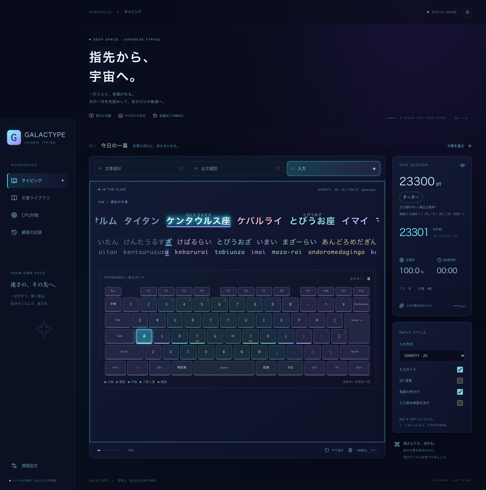

# GALACTYPE

指先から、宇宙へ。長文・単語・CPU対戦を楽しむ、宇宙テーマのタイピングゲーム。

文章選択・全文確認・入力を、横回転する3面のカルーセルで切り替えます。練習中は現在の一文と次の一文を表示し、先を読みながら自分のリズムで打てます。通常練習は自分の最初の打鍵で始まり、CPU対戦はカウントダウンで同時に始まります。



## 起動

Node.js 24、pnpm 11.25.0 を利用します。

```sh
corepack enable
pnpm install
pnpm dev
```

ブラウザで http://localhost:5173 を開きます。ビルドは `pnpm build`、ビルド結果の確認は `pnpm preview`。静的ホスティングには `dist/` を配置できます（ルートパス配信を想定）。

## 練習

1. 「文章選択」画面で好みの一篇を選びます。「文章ライブラリ」からも選べます。文学・旅・科学・日常・思索・音楽のオリジナル文章を各 3 段落、合計 6 編に加え、日本国憲法前文（4段落）の全文を収録しています。
2. 「全文を読む」で全段落を確認し、「この文章でスタート」で入力画面へ回転します。上部のステップでも移動できます。全文・文章選択へ戻ると一時停止します。画面は一度に1面だけ表示し、隠れた面はキーボード操作の対象から除外します。
3. 入力方式を選び、**IME を OFF / 直接入力**にします。入力領域をクリックし、最初の文字を打つと計測が始まります。句読点も入力します。
4. 入力に合わせてガイドが変わります。誤入力は進行せず、ミスとして計上。Backspace で戻す必要はありません。
5. Escape または一時停止で休止できます。入力欄からフォーカスが外れたとき、タブが非表示になったときも自動休止。再開ボタンから続きを打てます。休止時間は計測に含めません。
6. 全段落を完走すると記録します。途中の練習は保存しません。「やり直す」、文章・入力方式の変更で最初からになります。

本文は句点ごとに一文ずつ進み、次の一文を小さく控えめに表示します。本文の現在位置はシアンで強調し、入力済み部分は暗く表示します。漢字の連続部分は対応する読み全体を一つの単位として強調し、かなは一文字単位で進みます。かな入力の濁点・半濁点は入力し終わるまで同じ文字を強調します。ミスでは位置が進みません。独立した「現在の読み」欄は設けず、メイン文章の直下にひらがな、その下にローマ字、最後に次の文章を表示します。入力済みローマ字を残し、残りの候補と次の一打を表示します。本文・ひらがな・ローマ字は折り返さず、それぞれ1行のまま入力位置へ滑らかに左送りし、画面幅変更にも追従します。かな入力ではローマ字を非表示にし、濁点の入力途中も「が」などを分断せず表示します。入力ガイド OFF はローマ字だけを隠し、ひらがなは残します。3D 背景も OFF にできます。本文と読みの対応は `src/passageReadings.ts` の明示的なデータで管理し、全文との一致をテストしています。新しい文章を追加する場合は漢字の読み対応も追加してください。本文は漢字かな混じり、判定は手動で用意した読みを使います（助詞「は」は `ha`）。

キーボードガイドはキーの共通ピッチ、行のずれ、Tab/Caps/Shift/Backspace/Spaceの幅、JISの縦長Enterを実物に近づけています。担当指ごとにネオンの色で区分し、F・Jにホーム位置の目印を表示します。次に押すキーだけが発光します（Shiftが必要な場合はShiftキーも発光）。選択したJIS／US／Dvorak／かな配列に連動し、必要なShiftは反対側の手を案内します。かな入力の濁点・半濁点も別キーとして追従します。一時停止・完走中は発光を止めます。画面上のキーボードは表示ガイドで、クリック入力は行いません。

漢字の上には、対応データの読みをふりがなとして表示します。単語の色分けはデフォルトONです。右側の「単語の色分け」で本文・かな・ローマ字の配色を切り替えられ、保存済みのON/OFF設定を優先します。3面のカルーセルは同じ高さを維持し、回転時に光のスイープが入ります。全文の段落も1行表示で、横スクロールして確認できます。「入力済み単語を消す」をONにすると、打ち終えた単語を非表示にし、残りを左へ送ります。OFFでは従来どおり入力済み部分をグレーアウトします。どちらもこのブラウザに保存します。濁点・半濁点や漢字の読みの途中で単語を消すことはありません。動きを減らす設定では回転と送りのアニメーションを止めます。

## point・称号

point = floor(正打鍵KPM × 補正正確率²)、補正正確率 = 正打鍵数 / (正打鍵数 + 加重ミス数)。途中経過・完走結果・履歴にpointと称号を表示します。pointに上限はなく、1000pt以上は最高称号に固定します。

ptには連続誤打の加重ミス数を使います。1回目から順に重み1、0.75、0.5、0.35、0.25、以降も0.25を加算し、正しい打鍵で連続回数をリセットします。実際の誤打数とミス箇所数（連続誤打を1箇所に集約）は別に残し、既存の正確率表示・RTC判定はミス箇所数を使います。長い別表記の途中やかなの濁点でも、正しい打鍵が入れば次のミスを別に数えます。誤打で費やした時間は速度に反映されます。既存の履歴は当時のミス数でpointを算出し、「旧ミス方式」と表示します。

| 下限pt | 称号           |
| ------ | -------------- |
| 0      | カメ           |
| 100    | ハリネズミ     |
| 200    | リス           |
| 300    | ネコ           |
| 400    | キツネ         |
| 500    | ウサギ         |
| 650    | ダチョウ       |
| 800    | プロングホーン |
| 1000   | チーター       |

走る速さをイメージした独自のゲーム内ランクです。計算式は[福島高専のe-typing活用報告（2019、p.40）](https://www.jstage.jst.go.jp/article/rrie/1/0/1_39/_pdf/-char/ja)を参考にしています。連続誤打の減点補正と独自称号を用いるため、当アプリのpointはe-typingの公式スコアとは別に扱います。

## CPU対戦

サイドバーの「CPU対戦」で設定し、開始します。通常練習と同じ4配列・ふりがな・表示オプションが使えますが、**次の文章は表示しません**。独自の短文20問をシャッフルして使用し、全員が同じ問題を同時に開始します。

- 一問を先に打ち切った側へ1点。10点先取で1ラウンド、4ラウンド先取（BO7）で勝利します。
- 先取した側が正確率95%未満、相手が95%以上なら相手がラウンドを獲得します。CPUは無誤打のため、プレイヤーが先に10点を取っても95%未満ならCPUのラウンドになります。正確率には同じ連続ミス集約を使います。同時完了は入力中の速度・正確率のトータルポイントで比較します。
- 各ラウンド冒頭に3秒のカウントダウン、各問題の終了後に650msの入力不能時間があります。連打の持ち越しによる意図しないミスを防ぎます。
- KPMはCPUの定常速度。反応時間は出題から**最初のキー**が入るまでの時間です。一定速度と、時定数700msで定常速度へ近づくイーズインを選べます。反応と加速を含む全体の実測KPMは設定値より低くなります。
- プリセットは90〜1200 KPMの10段階で、反応時間はカメ250ms〜ハヤブサ140msです。人間の反応をイメージしたゲーム内の調整用プリセットです。設定はこのブラウザに保存します。
- Escape、一時停止、フォーカス離脱、ブラウザの非表示で停止し、再開までCPUの時計も止まります。対戦中の設定変更はリセット後に行います。別のアプリ内画面へ移ると進行中のCPU対戦は終了します。完了した対戦だけを履歴へ1回保存します。

ルールの参照: [RTC2025公式の競技ルール](https://www.realforce.co.jp/events/202503_typing-championship/)、[Weather Typing公式FAQ（速度・正確性・トータルポイント）](https://denasu.com/software/wtfaq.html)。大会の問題文・画像素材は使用していません。

## 入力方式

| 方式       | 動作                                                                                    |
| ---------- | --------------------------------------------------------------------------------------- |
| QWERTY JIS | `KeyboardEvent.key` を使い、JIS の記号位置を OS に従って処理                            |
| QWERTY US  | `KeyboardEvent.code` で US 配列の物理キーを復元                                         |
| Dvorak     | 物理キーを標準 US Dvorak に変換。**OS の配列は QWERTY** のまま利用（二重変換を避ける）  |
| JIS かな   | 物理キーを JIS かなに変換。濁点・半濁点は別打鍵、小書き文字・句読点は Shift。IME は OFF |

### ローマ字判定

固定の正解文字列と比較せず、読み位置と未完の綴りを持つ候補集合で判定します。候補は入力ごとに絞り込み、別綴りを混ぜて入力できます。

- `し`: `shi / si / ci`、`ち`: `chi / ti`、`つ`: `tsu / tu`、`じ`: `ji / zi`
- `しゃ`: `sha / sya / shixya / silya` など、拗音の一括・分割入力
- 小書き文字の `x / l`、`っ` の `xtu / ltu / xtsu / ltsu`、子音重複 (`kka / ssya / tchi` など)
- `ん`: `nn / n' / xn`、後続が子音なら `n`。`んあ` は `nna`、`んな` は `nna / nnna`。末尾の `ん` 単独は `nn / n' / xn` を使用
- `ふぁ / うぃ / てぃ / でゅ / くぁ / ゔぁ` などの外来音と、小書き文字に分ける入力
- `、。ー「」！？` はローマ字方式では `,.-[]!?`

対応表は [src/engine.ts](src/engine.ts)、回帰例は [src/engine.test.ts](src/engine.test.ts) を参照してください。e-typing / Typewell の非公開判定仕様と完全一致することは保証していません。追加の綴りは判定表とテストの組で拡張できます。JIS 実機のメーカー固有キー・OS/ブラウザ差、および全 IME 固有拡張は未検証です。

ハードウェアキーボード向けです。スマートフォン幅では閲覧できますが、ソフトウェアキーボード入力は対象外です。

## 記録とプライバシー

- localStorage キー: `yohaku.history.v1` / `yohaku.settings.v1` / `yohaku.cpu.v1`。外部サーバーへの記録送信なし。履歴は最新 200 件。
- KPM = 正しく受け付けた打鍵数 ÷ 実測分数。正確率 = 正打鍵 ÷（正打鍵 + ミス）× 100。長い別綴りも実打鍵数に含むため、綴りにより KPM は変わります。
- 複数タブの履歴追加・削除を同期します。HTTPS / localhost の対応ブラウザでは Web Locks API で同時書き込みを排他制御。非対応環境でも保存直前に最新履歴へ統合しますが、同時書き込みの排他保証はありません。
- 文章・入力方式の組ごとに自己ベストを表示。かな入力とローマ字入力の KPM は直接比較しないでください。
- JSON 書出し、全履歴の確認付き削除。JSON 再取込機能はありません。
- 保存が拒否された場合もメモリ内で練習できます。警告を表示し、履歴は JSON で退避可能。破損データは読み飛ばします。
- ブラウザのデータ削除・別端末・プライベートブラウズでは履歴を引き継げません。

## デザインと技術

React / TypeScript / Vite / Tailwind CSS v4 / Three.js / Lucide。濃紺・シアン・紫の宇宙テーマに、本文の影と現在位置のネオン発光を組み合わせています。正打鍵では短いリング・粒子が出ます。ミスタイプでは画面の縁に約 0.5 秒の赤いダメージ演出が出ます。全画面演出はクリックや打鍵を遮らず、連続ミスでも一つだけ表示し、一時停止・やり直し・完走で消去します。`prefers-reduced-motion` では正打鍵の演出を隠し、ミスは静的な細い枠で伝えます。

背景は恒星、異なる表面模様の 6 惑星、リング、星の粒子が奥行き方向へ流れる恒星系です。惑星の小さなテクスチャを端末内で生成し、画像の外部取得は行いません。Three.js は遅延ロードし、背景 OFF 時はロードしません。描画は最大 30 fps、ピクセル比 1.5・描画面積 160 万画素を上限とします。非表示タブではアニメーションを停止します。`prefers-reduced-motion` では静止し、リサイズ時のみ再描画します。WebGL が使えない場合やコンテキストを失った場合は CSS の惑星に切り替えます。背景 OFF・アンマウント時に描画ループ、イベント監視、ジオメトリ・マテリアル・テクスチャを解放します。

## 検証・GitHub Flow

```sh
pnpm lint
pnpm typecheck
pnpm test
pnpm build
pnpm exec playwright install chromium
pnpm test:e2e
```

入力・配列・全文の到達可能性・保存障害を Vitest で検証。Playwright は毎回ビルドした本番用ファイルを専用ポート 4173 で起動して検証します。本文・ひらがな・ローマ字の対応、別綴り、濁点途中、全画面ミス演出とその消去、惑星の移動と静止設定、WebGL 不可時の代替表示、背景の再表示を検証します。長文完走・停止/再開・履歴の再読込・書出し/削除・文章選択・設定保存・390px 幅・ガイド OFF 時の読み位置追従・画面幅変更・複数タブの同時完走と削除同期も確認します。スクリーンショットは `artifacts/` に出力。CI は PR 時に同じチェックを実行します。

Issue → feature ブランチ → PR → CI → レビュー → main の順に開発します。初回の設計・実装は [Issues #1–#6](https://github.com/ks250206/typing/issues) を参照。マージ・公開は別途実施します。

## タイプウェルの文章セット

専用のナビゲーションや独立したゲームモードは設けず、文章選択・ライブラリに「基本常用語」「カタカナ語」「漢字」「慣用句・ことわざ」「宇宙の名前」の5セットを追加しています。JIS/US/Dvorakでは国語R相当の400自然打鍵分、かな入力では国語K相当の280打鍵分です。単語は復元抽出で毎回ランダム、区切りの半角スペースも1打分に含めます。最後は単語・音節の途中でも終了します。

出題は入力を始める前に、文章セット・シード・配列からすべて確定します。単語をランダムに抽出してスペースでつなぎ、自然な短いローマ字表記を基準に400キーの参照列（かなは濁点別打鍵を含む280キー）を作り、末尾の単語・音節の途中にある終了位置まで固定します。入力中に次の単語を追加したり、表示範囲や末尾を作り直したりしません。最後の単語はふりがなを正しく見せるため全体を表示し、入力が必要なローマ字は固定の終了位置で切ります。

別の有効なローマ字表記は受け付けます。`sanka`と`sannka`は同じ「参加」までを打ち、余計な`n`で出題の末尾を移動しません。長い表記は実打鍵数だけ増え、終了までの基準打鍵数・KPM・ptを増やしません。計測開始ボタンやカウントダウンはなく、通常の文章と同じく最初の打鍵で時計が動きます。休止中の時間は計測に含めません。

「シードを固定する」をONにし、任意の文字列を入力して「このシードを使う」を押すと再出題できます。OFFでは選び直し・やり直しのたびに新しい乱数シードを使います。再現IDはセットID / 出題バージョン / シード / 配列です。現行はv2で、出題範囲の固定と宇宙辞書の拡充を反映しています。新しい履歴にはバージョンも保存し、v1の履歴は旧シード処理・旧64語辞書を使って同じ基準キー列を再現します。乱数はFNV-1a + Mulberry32、プレイ中の外部通信はありません。

ルールの確認には[非公式ブラウザ版の出題・入力処理](https://github.com/fiore57/typewell-in-browser/blob/main/src/lib/typing.ts)と[タイプウェル国語R/Kの種目・打鍵数の記録](https://w.atwiki.jp/typer/pages/51.html)を参照しました。元ソフトそのものの完全移植ではありません。既存の1行表示・左送り・色分け・pt表示を共用します。最終単語は漢字と正しいふりがなを保つため全体を表示し、実際に必要なローマ字だけを終了位置で切ります。

### 辞書の出典と集約

ユーザー指定の公開リスト、kouy（山原コウ）氏の[タイプウェル練習](https://typing.twi1.me/bookmark/id/13601)に掲載された問題文の単語・読みを組として取得。ページごとの分割を結合し、語順と重複を保持しています（掲載リストと原ソフト辞書の完全一致は保証しません）。合計10,728項目です。`scripts/import-typewell.py`で同じ17ページから再集約でき、`src/data/typewell.json`を静的に同梱するためプレイ中の外部通信はありません。

| 文章セット       | 集約件数 | 出典ページのgame ID                                                                                                                                                                                                                                                    |
| ---------------- | -------: | ---------------------------------------------------------------------------------------------------------------------------------------------------------------------------------------------------------------------------------------------------------------------- |
| 基本常用語       |    2,154 | [91013](https://typing.twi1.me/game/91013), [91435](https://typing.twi1.me/game/91435), [91437](https://typing.twi1.me/game/91437)                                                                                                                                     |
| カタカナ語       |    3,170 | [91438](https://typing.twi1.me/game/91438), [91440](https://typing.twi1.me/game/91440), [91441](https://typing.twi1.me/game/91441), [91442](https://typing.twi1.me/game/91442), [91443](https://typing.twi1.me/game/91443), [91444](https://typing.twi1.me/game/91444) |
| 漢字             |    3,330 | [91453](https://typing.twi1.me/game/91453), [91454](https://typing.twi1.me/game/91454), [91457](https://typing.twi1.me/game/91457), [91461](https://typing.twi1.me/game/91461)                                                                                         |
| 慣用句・ことわざ |    2,074 | [91462](https://typing.twi1.me/game/91462), [91466](https://typing.twi1.me/game/91466), [91467](https://typing.twi1.me/game/91467), [91468](https://typing.twi1.me/game/91468)                                                                                         |

CPUプリセットは90〜1200 KPMの10段階です。反応時間はカメ250ms・ハリネズミ235ms・リス220ms・ネコ210ms・キツネ200ms・ウサギ190ms・ダチョウ180ms・プロングホーン165ms・チーター150ms・ハヤブサ140msです。保存済みの旧プリセットは新しい反応時間へ移行し、個別に調整したカスタム値は維持します。人間の特定集団を測定したデータではなくゲーム用の設定値です。KPM・反応時間・一定速度/イーズインは個別にも変更できます。CPU対戦のローマ字はYOU/CPUの2行を直下に並べ、同じ表記・等幅の文字セル・単語間隔・共通の横送りで表示します。プレイヤーがshi/siやn/nnなどの別表記を使うとCPU行も同じ文字列に合わせ、CPU自身の入力位置をその表記へ投影します。CPUの速度や勝敗計算は変えません。2行は単語の色分けをせず、入力済み部分を暗く、現在位置を下線で示し、「YOUが先行 / CPUが先行 / 同じ位置」を表示します。入力済み単語を消す設定でも比較行の全文は保持して座標をそろえます。かな入力も両者の進捗を同じローマ字へ投影し、入力ガイドOFFでは比較行を隠します。反応待ち・一時停止・問題切替も両行で同期します。

### 宇宙の名前（タイプウェル準拠・GALACTYPEオリジナル）

恒星453語・銀河8語・小惑星10語・衛星16語・惑星8語・星座88語、計583語を `src/spaceWords.ts` に収録しています。「タイプウェル準拠 · 宇宙の名前」を文章選択・ライブラリから選べます。既存4セットと同じスペース区切り・自然打鍵R400/K280・ランダム出題・シード固定・履歴再現に対応します。タイプウェル本家の収録辞書ではなく、同じ出題形式を使う独自のセットです。基本4辞書の内容は維持し、出題バージョンを分けて旧履歴の再現にも対応します。

恒星追加分の日本語表記は[標準恒星名表記](https://www6338.la.coocan.jp/starnames.html)、88星座は[国立天文台の一覧](https://www.nao.ac.jp/new-info/constellation.html)を参照し、2026年10月29日の名前・読みのスナップショットを `src/data/spaceCatalogue.json` に保存しています。`scripts/import-space-catalogue.py`で再取得できます。もともとの64語と同じ天体の別表記は重ねて追加しません。

その他の名称の参照先: [国立天文台・おもな恒星](https://eco.mtk.nao.ac.jp/koyomi/faq/stars.html)、[福井県自然保護センター・銀河の世界](https://fncc.pref.fukui.lg.jp/tenmoninfo/galary/galaxy)、[NASA・小惑星](https://science.nasa.gov/solar-system/asteroids/)、[JAXA・プラネタリーディフェンス](https://www.isas.jaxa.jp/missions/planetary_defense/)、[JPL・衛星一覧](https://ssd.jpl.nasa.gov/sats/phys_par/sep.html)。名称と読みを練習用に編集し、資料の説明文・画像は収録していません。銀河名を含む漢字の読みは明示的に管理します。

画面、HTMLタイトル・説明、favicon、JSON書き出し名はGALACTYPEに統一しています。保存済みの設定・履歴を引き継ぐため、localStorageの内部キーは従来の `yohaku.*` を維持しています。

## 日本国憲法 前文

「公的文章」カテゴリの「日本国憲法 前文」で、[衆議院掲載の原文](https://www.shugiin.go.jp/internet/itdb_annai.nsf/html/statics/shiryo/dl-constitution.htm#zen)の前文4段落を省略せず練習できます。公布文や本文の条文は含めず、段落頭の字下げとHTMLの改行を除いた本文を収録しています。

表示は原文の歴史的仮名遣い（わたつて・やう・ゐる・思ふ等）を保持し、ふりがな・入力判定は現代の読み（わたって・よう・いる・おもう等）を使います。明示的な本文／読み対応を `src/constitution.ts` に収録し、全9文を通常の長文と同じく順に入力します。漢字のふりがな、単語の色分け、左送り、JIS/US/Dvorak/かな入力、停止・履歴保存に対応します。
