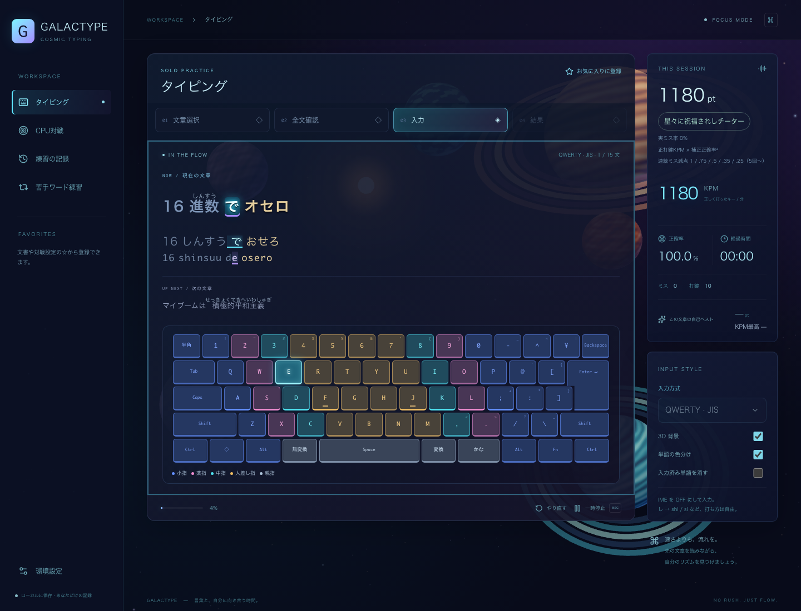

# GALACTYPE

指先から、宇宙へ。長文・単語・CPU対戦を楽しむ、宇宙テーマのタイピングゲームです。ブラウザだけで動き、記録は端末内に保存します。



## 目次

- [特徴](#特徴)
- [遊び方](#遊び方)
- [モード](#モード)
- [文章セット](#文章セット)
- [入力方式](#入力方式)
- [操作キー](#操作キー)
- [スコアと称号](#スコアと称号)
- [記録とプライバシー](#記録とプライバシー)
- [設定](#設定)
- [動作環境](#動作環境)
- [出典](#出典)
- [開発者向け](#開発者向け)

## 特徴

- **日本語・英語の豊富な文章セット**：オリジナル長文、日本国憲法、タイプウェル・e-typing・RTC準拠の問題集など
- **6つのモード**：通常練習・一文練習・CPU対戦・ゴースト対戦・苦手ワード練習・記録リプレイ
- **10種類の入力配列**：QWERTY（JIS/US）・Dvorak・Colemak・Workman・大西・AZERTY・Norman・NOVA F5-Pair・JISかな
- **柔軟なローマ字判定**：`shi / si`、`n / nn` などの別綴りを混ぜて入力可能
- **詳しい分析**：1秒ごとの速度グラフ、ミス箇所・タイムロス、全打鍵ログ、歴代TOP10
- **シードで再現**：同じ出題を何度でも練習・対戦できます

## 遊び方

1. **文章選択**：ライブラリから文章セットを選びます。日本語 / English の切り替え、ジャンル絞り込み、検索ができます。
2. **全文確認**：出題される本文を確認します。
3. **練習**：IMEをOFF（直接入力）にして入力欄をクリックし、**Space** を押すと3秒のカウントダウン後に開始します。
4. **結果**：完走すると結果画面へ移り、point・称号・速度グラフ・ミス箇所を確認できます。

- 誤入力では位置が進まず、Backspaceで戻す必要はありません。
- 本文の下にひらがな・ローマ字のガイドと、次に押すキーを光らせるキーボードを表示します。
- フォーカスが外れる・タブを切り替えると自動で一時停止し、休止時間は計測に含めません。
- 途中でやめた練習は記録しません。

## モード

| モード         | 内容                                                                               |
| -------------- | ---------------------------------------------------------------------------------- |
| 通常練習       | 文章セットを最後まで打ち切る基本モード。一文ずつ進み、次の一文を小さく表示します。 |
| 一文練習       | 同じ文を指定回数くり返し、平均KPMとミス数の目標達成を目指します。                  |
| CPU対戦        | 速度と反応時間を設定したCPUと、同じ問題で先取りを競います（BO7）。                 |
| ゴースト対戦   | 保存した自分の記録の打鍵を再生する「ゴースト」とタイムレースをします。             |
| 苦手ワード練習 | 過去の打鍵ログからミス・タイムロスの多い単語を選んで反復します。                   |
| 記録・リプレイ | 記録の推移・ランキング・詳細分析を確認し、保存した打鍵を再生します。               |

### 一文練習

- 日本語・英語の文章セットから1文（TypeWellは1語）を選び、既定5回くり返します。
- **全回の平均KPMが目標以上**（既定600）、かつ**合計の実ミスが上限以下**（既定10）で成功です。ミスが上限を超えた時点で失敗として終了します。
- 回数（1〜50）・目標KPM（10〜3,000）・ミス上限（0〜100）は変更でき、文・語ごとの Best KPM / 直近KPM / 試行回数を一覧で確認できます。
- 結果はこのモード専用に保存し、通常の練習記録には加えません。

### CPU対戦

- 一問を先に打ち切った側に1点。**10点先取で1ラウンド、4ラウンド先取（BO7）で勝利**です。
- 先に10点を取っても**正確率95%未満**なら、相手が95%以上のときは相手のラウンドになります（CPUは誤打しません）。
- CPUは **KPM（35〜1800）・反応時間（100〜1500ms）・打ち方（一定速度 / 徐々に加速）** を設定できます。称号と同じ21段階のプリセットもあります。
- タイプウェル系の文章セットは、指定した単語数（既定5、1〜50）を空白でつないで1問にします。
- 各ラウンド後にスコア・速度推移・ログを確認してから次へ進みます。完了した対戦だけを1件記録します。
- ルールは [RTC2025公式の競技ルール](https://www.realforce.co.jp/events/202503_typing-championship/) と [Weather Typing公式FAQ](https://denasu.com/software/wtfaq.html) を参考にしています。

### ゴースト対戦

- 「練習の記録」から記録を選んで開始します。ゴーストは保存時の別綴り・ミス・打鍵間隔をそのまま再現します。
- 最初の打鍵で両者の時計が同時に動き、ログの最終到達地点へ先に着いた側の勝ちです。
- 結果は「ゴースト対戦」として別に保存し、元の記録は変更しません。

### 苦手ワード練習

- 直近200件の記録から、ミスや遅れ（中央値より合計120ms以上）のある単語を最大100件候補にします。
- 最大20語を選び、各1〜20回（既定5回）くり返します。練習済みの語は候補から外せます。
- 結果は履歴や文章別の分析に含めません。

### 記録・リプレイ

- 文章セット・配列・モードごとに、pointとKPMの歴代TOP10、前回比、直近5回の移動平均、推移グラフを表示します。
- 「詳細を見る」で1秒区間のKPM・ミス率、ロスの大きいキー、全打鍵ログを確認できます。
- 「リプレイを見る」で打鍵を再生できます（0.25〜4倍速、1打鍵送り、シーク）。
- 「シードを再現」で同じ出題を再練習できます。

## 文章セット

文章選択のライブラリから選びます。通常練習・CPU対戦の両方で使えます（一部は一文練習にも対応）。

| 区分           | 内容                                                                                 | 出題                      |
| -------------- | ------------------------------------------------------------------------------------ | ------------------------- |
| オリジナル     | 文学・旅・科学・日常・思索・音楽の独自文章6編、詩・翻訳2編                           | 全文を一文ずつ            |
| オリジナル長文 | 7テーマ×3難易度の21編と、歴史・科学の解説5編                                         | 全文を1問として           |
| 公的文書       | 日本国憲法の前文（全文）、主要14条の条文集                                           | 全文 / 14条をランダム順   |
| タイプウェル   | 基本常用語・カタカナ語・漢字・慣用句ことわざ、宇宙・科学者・SF小説・スポーツチーム名 | ローマ字400打 / かな280打 |
| e-typing       | Weather Typing用XMLから26タイトル                                                    | ランダム15問              |
| RTC            | RTC2018〜2025の提供ワード、RTCオリジナル200文、AI・機械学習のRTC風フレーズ           | ランダム15問              |
| 60秒トレーナー | さくさくタイピング・高速タイピング・長文鍛錬用・シェイクスピア・ノーベル賞           | 60秒間ランダム出題        |
| English        | オリジナル・オリジナル長文・e-typing 19タイトル・TypeWell英単語4辞書の計29セット     | セットにより15問 / 400打  |

- ランダム出題のセットは**シード**で出題を再現できます。「シードを固定する」をONにすると同じ問題を練習でき、記録からも同じ出題を呼び出せます。
- 英語は大文字・小文字・句読点・空白をそのまま入力します。

各セットの収録数・出題方法・出典は [docs/CONTENT.md](docs/CONTENT.md) にまとめています。

## 入力方式

| 方式                                       | 内容                                                       |
| ------------------------------------------ | ---------------------------------------------------------- |
| QWERTY · JIS                               | OSの入力をそのまま使用                                     |
| QWERTY · US                                | 物理キー位置からUS配列を再現                               |
| Dvorak / Colemak / Workman / 大西 / Norman | 物理キー位置をアプリ内で各配列に変換                       |
| AZERTY · French                            | Microsoft French Legacy準拠。AltGr（またはCtrl+Alt）に対応 |
| NOVA F5-Pair                               | JIS物理配列の48キーに対応                                  |
| JIS かな                                   | 濁点・半濁点は別打鍵、小書き文字・句読点はShift            |

- **OS側はQWERTY・IME OFFのまま**使ってください。配列の変換はアプリが行うため、OS側でも同じ配列にすると二重に変換されます。
- ローマ字は別綴りを混ぜて入力できます（例：`し` = `shi / si / ci`、`しゃ` = `sha / sya`、`っ` = `xtu / ltu` や子音重複、`ん` = `nn / n' / xn`、後続が子音なら `n`）。
- 句読点は `、。ー「」！？` → `,.-[]!?` です。
- かな入力とローマ字入力のKPMは直接比較しないでください。

## 操作キー

| 場面                     | キー                                                    |
| ------------------------ | ------------------------------------------------------- |
| 開始                     | Space（クリックでも可）                                 |
| 一時停止                 | Escape                                                  |
| 一時停止からの再開       | Space / Escape / Enter                                  |
| やり直し                 | 一時停止中・結果画面で R                                |
| 文章選択へ戻る           | 開始待ち・一時停止・結果画面で C（CPU対戦は対戦設定へ） |
| 画面の切り替え（練習外） | 1 文章選択 / 2 全文確認 / 3 練習 / 4 結果               |
| CPU対戦の次のラウンド    | N / S / Space / Enter                                   |

入力欄やフォームの操作中、IME変換中、修飾キー付きの操作ではショートカットは動作しません。

## スコアと称号

- **point** = floor(正打鍵KPM × 補正正確率²)。補正正確率では、同じ箇所の連続ミスを1回目から 1・0.75・0.5・0.35・0.25… と減らして数えます。
- **称号**は50pt刻みの動物21段階（カメ〜チーター）に、実ミス率に応じた接頭辞（例：「星々に祝福されし」「精緻な」）を付けます。
- 表示する**正確率**とCPU対戦の95%判定は、連続ミスも1打ずつ数える実ミスで計算します。
- **KPM**は正しく受け付けた打鍵数 ÷ 分。タイプウェルのスコアは基準400 / 280打で計算します。

称号・接頭辞・CPUプリセットの一覧と計算の詳細は [docs/SCORING.md](docs/SCORING.md) を参照してください。

## 記録とプライバシー

- 記録・設定・打鍵ログはすべて**ブラウザ内**（localStorage・IndexedDB）に保存します。外部サーバーへの送信はありません。
- 記録はJSONで書き出せます（再取り込みには未対応）。
- 「環境設定」→「記録をすべて消去」で、履歴・TOP10・打鍵ログを削除できます。設定と文章セットは残ります。
- 複数タブで開いても記録の追加・削除は同期されます。
- ブラウザのデータ削除・別端末・プライベートブラウズでは記録を引き継げません。保存できない環境では警告を表示し、その画面では練習を続けられます。

## 設定

右サイドバーと「環境設定」から変更でき、ブラウザに保存されます。

| 設定                         | 内容                                             |
| ---------------------------- | ------------------------------------------------ |
| 入力方式                     | 上記10配列から選択                               |
| 単語の色分け                 | 本文・かな・ローマ字を単語ごとに色分け（既定ON） |
| 入力済み単語を消す           | 打ち終えた単語を消して残りを左へ送る（既定OFF）  |
| 3D 背景                      | 恒星系の背景のON/OFF                             |
| 画面の表示倍率               | 75〜150%                                         |
| 画面切り替えのアニメーション | オン / OSに合わせる / オフ                       |

背景・打鍵・メニューなどの演出は、OSの「動きを減らす」設定にも従います。

## 動作環境

- ハードウェアキーボードのあるPC向けです。スマートフォン幅でも閲覧できますが、ソフトウェアキーボードでの入力には対応していません。
- WebGLが使えない場合、3D背景はCSSの簡易な背景に切り替わります。

## 出典

問題集の出典の概要です。詳細と取得元のリンクは [docs/CONTENT.md](docs/CONTENT.md) を参照してください。

- **タイプウェル**：kouy（山原コウ）氏の公開リスト [タイプウェル練習](https://typing.twi1.me/bookmark/id/13601) の単語・読み
- **e-typing**：[uaaaaaaaa.com のタイピング問題集](https://uaaaaaaaa.com/typing/word) のWeather Typing用XML
- **RTC**：ユーザー提供のRTC公式ワードZIP（再配布の許諾を確認できていないため、ZIPはリポジトリに含めていません）
- **English**：[physics-HTFI / TypeLighter](https://github.com/physics-HTFI/TypeLighter) の付属ワード
- **日本国憲法**：[衆議院掲載の本文](https://www.shugiin.go.jp/internet/itdb_annai.nsf/html/statics/shiryo/dl-constitution.htm)
- **pointの計算式**：[福島高専のe-typing活用報告（2019、p.40）](https://www.jstage.jst.go.jp/article/rrie/1/0/1_39/_pdf/-char/ja) を参考にした独自の式です。e-typing・タイプウェル・RTCの公式スコアや判定とは一致しません。

## 開発者向け

セットアップ、ソースコードの構成、問題データの再生成、テストとCI、開発フローは [docs/DEVELOPMENT.md](docs/DEVELOPMENT.md) を参照してください。

Node.js 26 を用意してから実行します。

```sh
npm install --global pnpm@12.16.1
pnpm install --frozen-lockfile
pnpm dev
```
